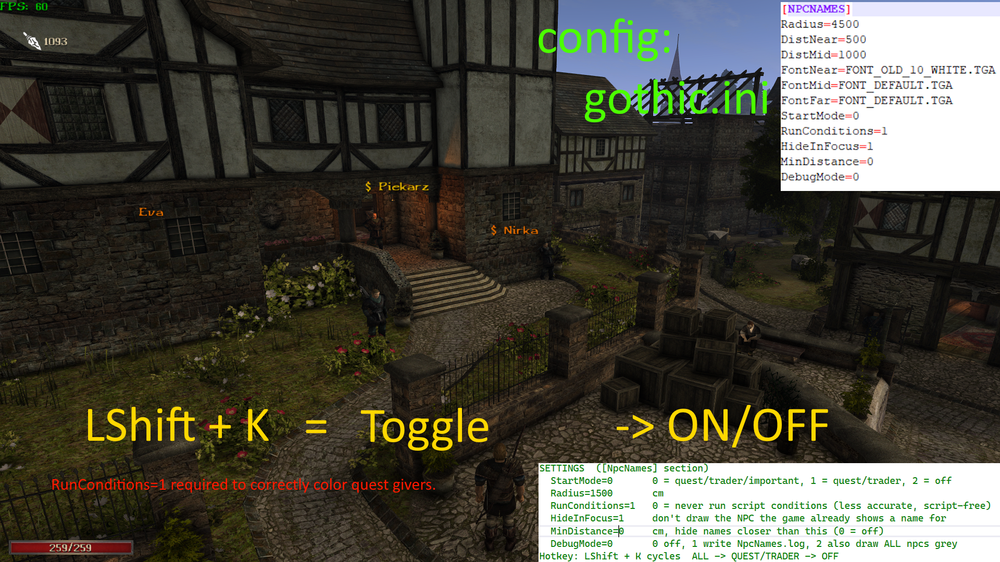

# Gothic2_NPCname
-> translate.google.com  
Renders names of npcs with support for any language, in radius around the player, without dependency on whether that npc is currently spawned or not. (radius can be configured)  
Colors those names based on hardset of rules. (see colors)
 
Gothic2 Night Raven NK; Union; shows quest givers NPC names on screen.  
should work for any mod based on Gothic2 Night Raven; tested on Chronicles of Myrtana and New Balance.  

Install:  
drop the NPCnames.dll into:  
Gothic2/system/Autorun  
if Autorun folder does not exist, install Union.  
  
or place .vdf in:  
Gothic2\Data\Plugins  
Requires Union 1.0m  

  

  
gothic.ini

// SETTINGS  ([NpcNames] section)  
//   StartMode=0       0 = quest/trader/important, 1 = quest/trader, 2 = off  
//   Radius=1500       cm  
//   RunConditions=1   0 = never run script conditions (less accurate, will not distinguish quest givers but is script-free)  
//   HideInFocus=1     don't draw the NPC the game already shows a name for  
//   MinDistance=0     cm, hide names closer than this (0 = off)  
//   DebugMode=0       0 off, 1 write NpcNames.log, 2 also draw ALL npcs grey  
//   FontNear=FONT_OLD_10_WHITE.TGA  
//   FontMid=FONT_DEFAULT.TGA  
//   FontFar=FONT_DEFAULT.TGA  
// Hotkey: LShift + K cycles  ALL -> QUEST/merchant -> OFF  
  
  
   

    
MODES/COLOR

Orange = quest giver *in the current moment* MEANING-> talk -> get quest -> name disappears  
Light Orange = NPC with which player not talked to yet or dialogue not yet heard
Cyan = NPC who will auto initiate conversation when in close range.  
$ Orange = quest giver + merchant
$ Gold = merchant  
Grey = LEFTOVER, NPCs who have dialogue, but nothing the mod can sort into quest, talk, trader or important.  
   

font size is equal to chosen font, FONT_DEFAULT.TGA seems to be the smallest.  
the logic uses cache which only does any calculation every 15sec, capped for only 3 NPCs per frame.  
the NPC name will be the exact bit value as in game, MEANING it supports all languages.  

RunConditions (default 1)  
    When enabled, the plugin asks the game whether each NPC's open dialogue options are currently available, using the same condition check the dialogue menu uses. This is what keeps false positives low.  
    This is guarded by a safe readonly externals whitelist. and various other safety features.  
      
    With RunConditions=0 no script code is ever run by this plugin, but names are shown for every NPC with an unfinished non-permanent dialogue, whether or not it is currently available. Expect many more false positives.  

